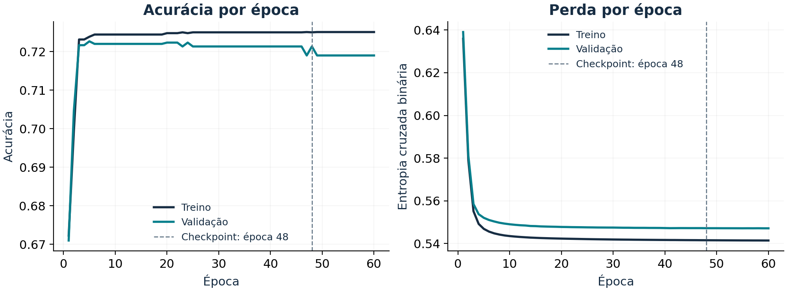
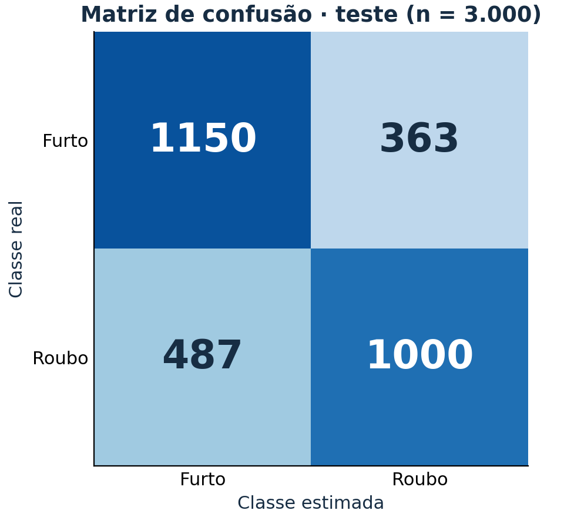

# Ocorrência SP · Classificação de roubo e furto com MLP

Global Solution da disciplina **Aprendizado Profundo com Redes Neurais Convolucionais**, FIAP.

| Integrante | RM |
|---|---|
| Arthur Casqueira Berthi | 568017 |
| Agatha Carolina | 568352 |
| João Dyonisio | 567087 |

Repositório: **https://github.com/ArthurBerthi505/global-solution-seguranca-sp-mlp**

Aplicação: **https://seguranca-sp-mlp-gs568017.tiledtoffee16.chatgpt.site**

O modelo classifica o tipo de uma ocorrência já registrada ou hipotética. **Ele não prevê se um crime acontecerá, não mede risco de uma região e não faz enquadramento jurídico.** O projeto utiliza registros reais, três MLPs efetivamente treinadas e resultados de teste reservados para o modelo escolhido na validação.

## Começar pela aplicação

Abra o link acima, selecione a região do fato e o contexto, e clique em **Classificar ocorrência**. As abas **Experimentos e resultados** e **Dados e método** mostram métricas, gráficos, origem e limitações. A inferência usa os pesos reais exportados de Python e funciona no navegador, sem API paga e sem envio das características a um servidor.

Para executar localmente, basta Python 3.11 ou superior. Os modelos fornecidos foram treinados com Python 3.12 e scikit-learn 1.8.0:

```bash
python -m http.server 8000 --directory web
```

Abra **http://localhost:8000**. Não abra `index.html` diretamente com `file://`, porque o navegador pode bloquear o carregamento dos arquivos JSON.

## Entregas e estrutura

```text
notebooks/GlobalSolution_MLP_SP.ipynb        Notebook documentado e executado
reports/Relatorio_GlobalSolution_MLP_SP.pdf  Relatório técnico de 10 slides
src/data.py                               Obtenção, limpeza e divisão dos BOs
src/model.py                              Treinamento, seleção e exportação
src/plots.py                              Gráficos reais dos experimentos
scripts/train.py                          Reprodução completa a partir da fonte
scripts/build_web.py                      Atualização da aplicação estática
web/                                      HTML, CSS, JS e pesos da MLP
models/mlp_bundle.joblib                   Rede escolhida + encoder Python
data/processed/auditoria.json              Filtros, contagens e hash da origem
reports/metrics.json                       Métricas calculadas
reports/histories.json                     Curvas por época, para as três redes
tests/test_pipeline.py                     Integridade e paridade Python/JavaScript
docs/                                     Fonte, metodologia e guia de apresentação
```

A distribuição pública contém código, modelo treinado, relatório e resultados agregados. A amostra e os resultados por ocorrência são gerados localmente por `scripts/train.py` ou pelo notebook e ficam excluídos do Git pelo `.gitignore`.

## Fonte pública e obtenção dos dados

- Coleção utilizada: [Crime Data in Brazil](https://www.kaggle.com/datasets/inquisitivecrow/crime-data-in-brazil), Marco Zanchi (`inquisitivecrow`), versão 1.
- Arquivo: **BO_2016.csv**, com 774.662 linhas de dados. Ano de referência: **2016**.
- O publicador atribui os dados à **SSP-SP**, obtidos a partir de pedido de informação, e fornece documentação RDO. O repositório inclui `docs/RDO_methodology.txt` e `docs/RDO_column_description.csv`, convertidos para UTF-8 sem alterar seu conteúdo.
- Referência institucional: [Consultas da SSP-SP](https://www.ssp.sp.gov.br/estatistica/consultas). O download direto dos arquivos atuais estava indisponível neste ambiente, então usamos a cópia histórica pública permitida pelo enunciado. Não apresentamos a cópia como uma base atual da SSP.
- Consulta: **12/11/2026**. Licença declarada pelo catálogo: **GPL 2**. Metadados em `docs/source_metadata.json`, atribuição em `docs/FONTE_E_DADOS.md` e licença em `LICENSE`.
- Download do arquivo específico: https://www.kaggle.com/api/v1/datasets/download/inquisitivecrow/crime-data-in-brazil/BO_2016.csv . O endpoint retorna um ZIP de cerca de 42 MB contendo um CSV de aproximadamente 319 MB. Se o portal alterar o endpoint, use a página da coleção e selecione o mesmo arquivo.
- Salve o ZIP como `data/raw/BO_2016.csv.zip`. O arquivo bruto não acompanha o repositório para evitar uma cópia grande e a divulgação desnecessária de endereços.
- SHA-256 do ZIP utilizado: `b2cf889131c62ab29e33a9fc10fd3b65dac46526ef1b82d150f60f1522fc334c`.

### Recorte do fato e consolidação

O dicionário descreve **CIDADE como cidade de registro**. Ela não é usada como filtro geográfico. Selecionamos `NOME_DEPARTAMENTO_CIRC = DECAP` e as oito `NOME_SECCIONAL_CIRC` da capital, que identificam a circunscrição do fato: Centro, Sul, Oeste, Norte, Leste, Santo Amaro, Itaquera e São Mateus. Esse recorte contém 510.586 linhas, independentemente de onde o boletim foi registrado.

Conforme a metodologia RDO, um boletim pode ocupar várias linhas por envolver pessoas, naturezas ou objetos diferentes. A chave é `(ID_DELEGACIA, ANO_BO, NUM_BO)`. Antes de amostrar, excluímos chaves inválidas, BOs com naturezas múltiplas, outras naturezas e casos com entradas conflitantes. Apenas naturezas exatas `Furto (art. 155)` e `Roubo (art. 157)`, com status `C`, definem os rótulos 0 e 1. Excluímos “Saidinha de Banco” de CONDUTA por sua associação semântica à classe roubo.

Restam **401.304 BOs únicos elegíveis**. Sorteamos **20.000**, por amostragem estratificada com semente 42, preservando a proporção original das classes. A amostra contém **10.087 furtos** e **9.913 roubos**. Todas as contagens por etapa estão em `auditoria.json`; contagens intermediárias de linhas e de BOs não são intercambiáveis.

### Duas entradas da rede

| Entrada | Origem | Transformação e justificativa |
|---|---|---|
| `regiao` | `NOME_SECCIONAL_CIRC` | Oito áreas da ocorrência. Localização agregada sem endereço nem coordenadas. |
| `contexto` | `CONDUTA` | Dez grupos gerais de ambiente/situação: banco ou caixa eletrônico, carga, comércio, ensino, interior de veículo, outros, residência, transeunte, transporte coletivo e veículo. |

O mapeamento completo está em `src/data.py` e no notebook. O contexto é um campo cadastral que pode ser influenciado pela natureza registrada, embora os grupos não revelem diretamente o rótulo. Essa limitação é declarada; uma extensão deve testar ablação de `CONDUTA` e usar tipo de local coletado independentemente da natureza. Não usamos o texto jurídico, a natureza, desdobramentos, violência/ameaça, identificadores, atributos pessoais, endereço ou delegacia de registro como entradas.

Contexto ausente recebe uma categoria explícita “Não informado”; ela não foi necessária na amostra. One-hot gera **18 entradas binárias** e aprende categorias somente no treino. Por estarem na mesma escala, essas entradas dispensam padronização.

## Instalação para reproduzir o treinamento

No PowerShell do Windows:

```powershell
py -3.12 -m venv .venv
.\.venv\Scripts\python.exe -m pip install -r requirements.txt
.\.venv\Scripts\python.exe scripts/train.py
.\.venv\Scripts\python.exe -m unittest discover -s tests -v
.\.venv\Scripts\python.exe -m jupyterlab
```

No Linux/macOS:

```bash
python3.12 -m venv .venv
.venv/bin/python -m pip install -r requirements.txt
.venv/bin/python scripts/train.py
.venv/bin/python -m unittest discover -s tests -v
.venv/bin/python -m jupyterlab
```

O script baixa o ZIP se necessário, prepara a amostra, treina as três redes, escolhe pela validação, avalia o teste e atualiza modelo, gráficos e aplicação. Execute os comandos **a partir da raiz do projeto**. A aplicação já funciona com os artefatos fornecidos, sem novo treinamento.

Na primeira execução, o notebook baixa a origem e gera a amostra local automaticamente. Se a amostra já existir, ela pode ser reutilizada sem novo download. Para forçar a preparação novamente, altere `REBUILD_FROM_SOURCE` para `True`. O comando de treinamento também gera localmente `reports/split_membership.csv` e `reports/test_predictions.csv`, usados nas verificações de integridade. Esses três CSVs por ocorrência não são distribuídos no GitHub nem no ZIP público. Os valores devem ser reproduzíveis no mesmo ambiente. Tempos e pequenas diferenças numéricas podem variar com versões e bibliotecas. Nunca carregue arquivos `.joblib` de origem desconhecida; o aplicativo publicado utiliza JSON.

## Protocolo dos experimentos

- Divisão estratificada após consolidação: **14.000 treino, 3.000 validação, 3.000 teste**. Os hashes de BO não se sobrepõem.
- ReLU nas camadas ocultas, sigmoid na saída única, entropia cruzada binária e Adam com taxa inicial **0,001**.
- Batch size **128**, até **80 épocas**, semente **42**, embaralhamento e parada após **12 épocas** sem redução mínima de **0,0001** na perda de validação. O checkpoint escolhido é restaurado. Os gráficos da perda exibem a entropia cruzada sem a parcela L2.
- Cada `partial_fit` percorre o treino uma vez e mantém o estado Adam. `early_stopping=False` evita criar uma validação interna diferente da prevista.
- Seleção entre arquiteturas: **maior F1 macro de validação**, com desempate por perda e quantidade de parâmetros. Precision/recall/F1 macro dão peso igual a cada classe.
- O teste não escolhe arquitetura, época nem limiar. Apenas o modelo selecionado e a referência majoritária recebem a avaliação final de teste.

| Rede | Camadas ocultas | L2 (alpha) | Parâmetros | Melhor época / executadas |
|---|---|---|---|---|
| MLP A | 16 | 0,0001 | 321 | 48 / 60 |
| MLP B | 32, 16 | 0,0001 | 1.153 | 46 / 58 |
| MLP C | 64, 32, 16 | 0,01 | 3.841 | 30 / 42 |

A é a referência simples. B amplia a capacidade. C testa profundidade maior com L2 mais forte. Como C altera dois fatores, não isolamos o efeito causal de profundidade e regularização.

### Resultados reais de validação

| Rede | Acurácia | Precision macro | Recall macro | F1 macro |
|---|---|---|---|---|
| **MLP A** | **72,13%** | **72,31%** | **72,09%** | **72,05%** |
| MLP B | 71,90% | 71,98% | 71,87% | 71,85% |
| MLP C | 72,20% | 72,61% | 72,14% | 72,04% |

Escolhemos **MLP A pelo maior F1 macro de validação**. A diferença de F1 para C é de aproximadamente 0,018 ponto percentual, insuficiente para alegar superioridade estatística. A também utiliza menos parâmetros.

### Teste final reservado

| Modelo | Acurácia | Precision macro | Recall macro | F1 macro |
|---|---|---|---|---|
| **MLP A selecionada** | **71,67%** | **71,81%** | **71,63%** | **71,60%** |
| Classe majoritária (sempre Furto) | 50,43% | 25,22% | 50,00% | 33,53% |

Matriz de confusão, com classe real nas linhas:

| Real / estimada | Furto | Roubo |
|---|---|---|
| Furto | 1.150 | 363 |
| Roubo | 487 | 1.000 |

No checkpoint, acurácias de treino e validação são 72,50% e 72,13%, um gap de 0,37 ponto percentual. Não observamos overfitting forte nessa divisão. O desempenho moderado nas duas partes pode refletir informação limitada nas duas entradas; não demonstra que uma rede maior resolveria essa limitação. Uma única divisão e semente não permitem concluir significância ou generalização para outros períodos.





## Integração e validação

`web/model.json` contém o mesmo one-hot, pesos e vieses de `models/mlp_bundle.joblib`. JavaScript implementa somente a passagem para frente da MLP. `tests/test_pipeline.py` compara as probabilidades de Python e JavaScript nas **80 combinações conhecidas** e em uma combinação desconhecida, com tolerância de `1e-12`. Os testes também verificam separação dos grupos, repetibilidade da divisão e consistência entre métricas salvas e previsões do teste.

O formulário oferece somente categorias conhecidas. Combinações raras recebem uma mensagem com seu suporte no treino. As probabilidades **não receberam calibração adicional**. Exemplo real do modelo treinado: `Norte + Transeunte` recebe aproximadamente **77,4% para a classe Roubo** e **22,6% para Furto**. A interpretação pressupõe que uma ocorrência aconteceu com essas características.

## Publicação e GitHub

A aplicação é estática e pode ser hospedada no GitHub Pages. O endereço funcional de entrega é o do início deste README. Para mudar a hospedagem, publique o conteúdo de `web/` preservando a estrutura e atualize o endereço no README.

O repositório público da equipe é https://github.com/ArthurBerthi505/global-solution-seguranca-sp-mlp. Ele contém o código completo, o notebook executado, o modelo treinado, os relatórios, resultados agregados, instruções de obtenção dos dados e este README. `docs/CHECKLIST_ENTREGA.md` relaciona as entregas. `docs/PUBLICAR_GITHUB.md` explica como clonar e atualizar o projeto.

## Limitações e uso responsável

Base histórica de 2016, registro administrativo, subnotificação, cobertura heterogênea, contexto cadastral e somente duas entradas agregadas. Dados de BOs não equivalem aos indicadores oficiais de criminalidade da SSP, conforme a metodologia RDO. As probabilidades refletem associações aprendidas, sem calibração adicional. O modelo não conhece violência, grave ameaça ou outros elementos necessários para uma análise jurídica do fato.

A solução é uma demonstração acadêmica. Não a utilize para patrulhamento, decisão sobre pessoas, avaliação de bairros ou como classificação jurídica de um registro real.

## IA generativa e compreensão da equipe

ChatGPT/Codex auxiliou na programação, preparação da interface, documentação e relatório. A preparação, o treinamento e os testes foram executados sobre dados reais. A equipe deve revisar o código e compreender suas decisões. O arquivo `docs/GUIA_APRESENTACAO.md` reúne explicações e perguntas de revisão, sem atribuir ao grupo uma revisão que ainda não realizou.

Possíveis próximos passos: base mais recente, ablação de CONDUTA, tipo de local independente da natureza, repetição com outras sementes e validação temporal. Essas mudanças exigem novo teste reservado.
